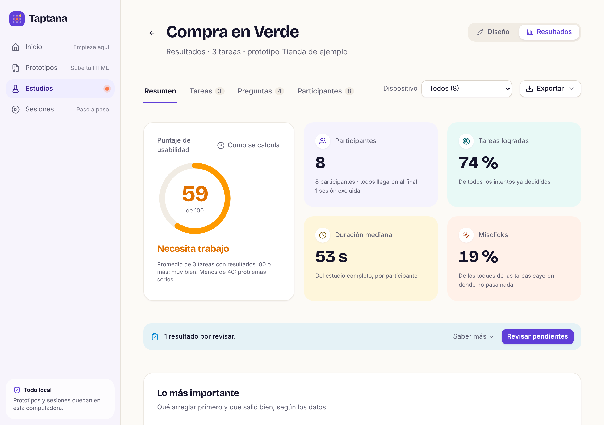
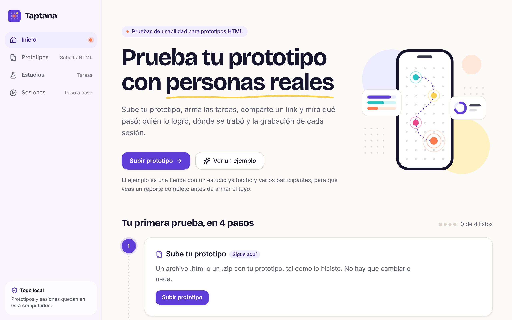
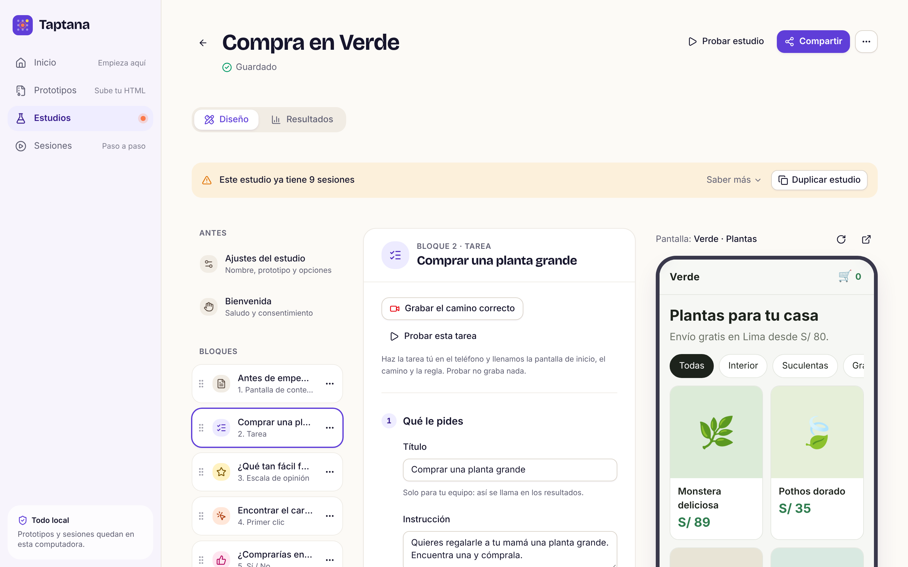
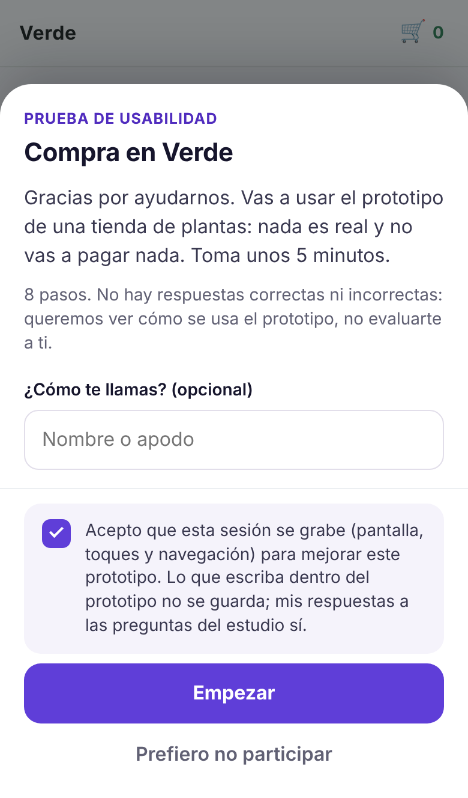
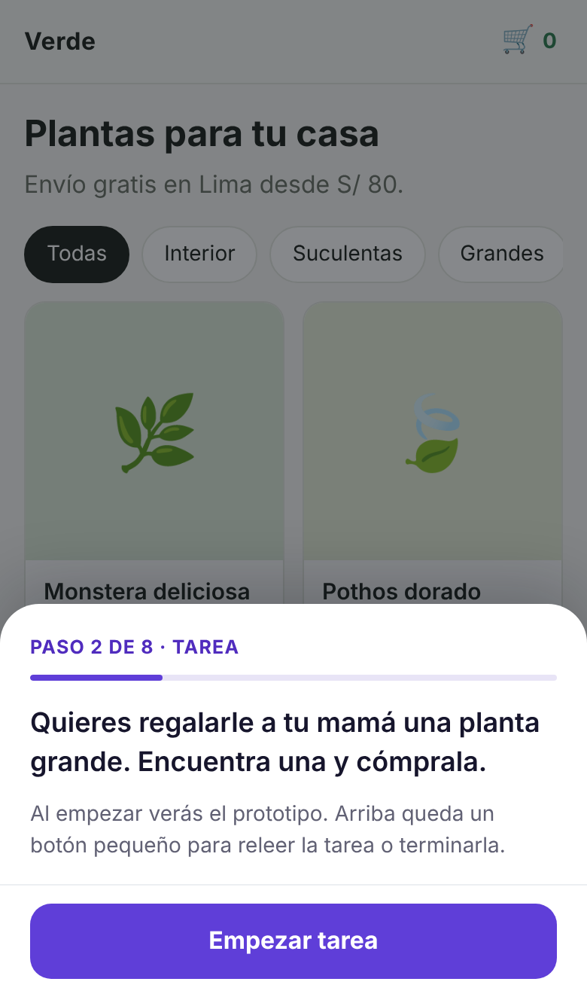
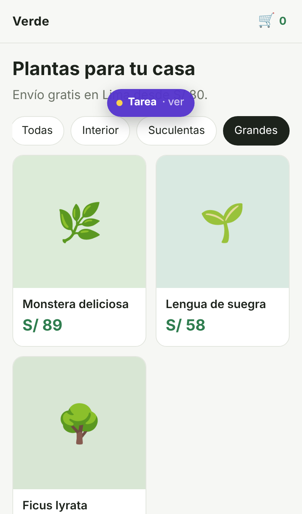
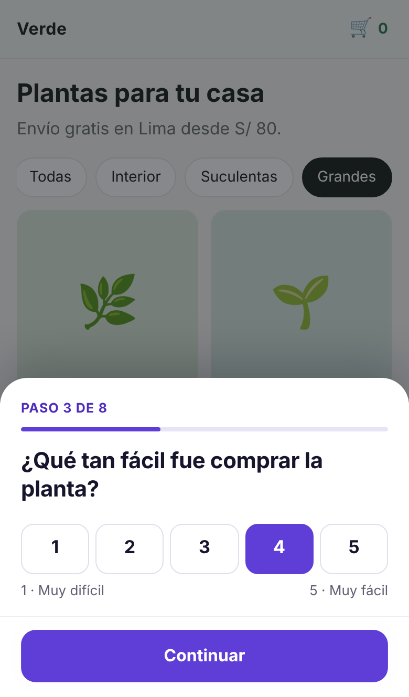
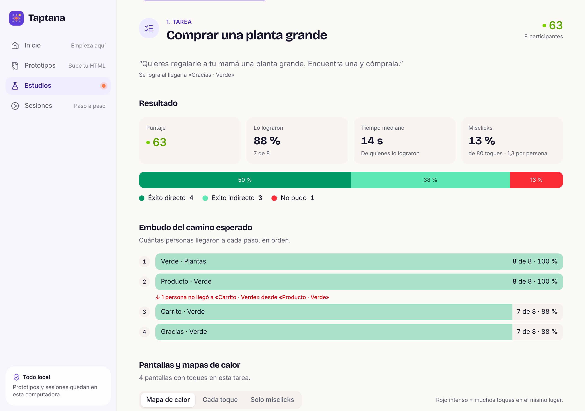
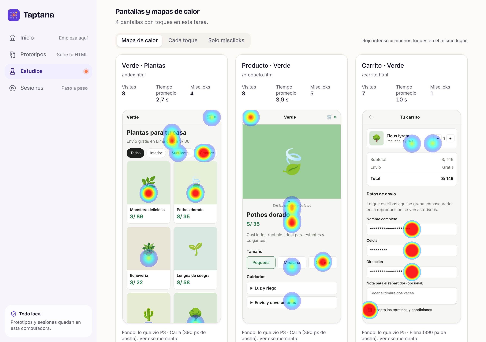
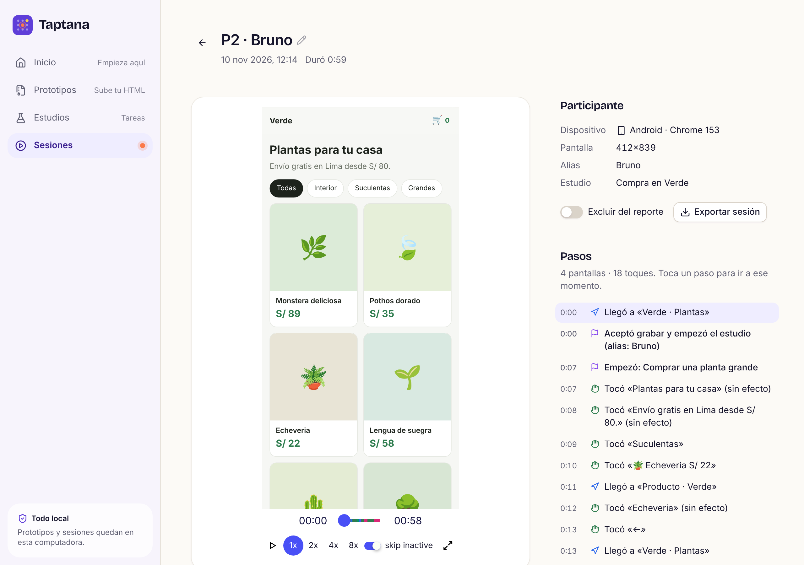

<p></p>

# Taptana

Pruebas de usabilidad para prototipos HTML, en celulares reales. Subes tu prototipo, armas las
tareas, compartes un link y ves qué pasó: quién lo logró, dónde se trabó y la grabación de cada
sesión. Open source (MIT) y todo queda en tu computadora.



**[Ver la demo](https://taptana.github.io/taptana/)** · [Guía paso a paso](docs/guia.md) · [Qué prototipos funcionan](docs/prototipos.md)

## Pruébalo en 2 minutos

Necesitas [Node 22.5 o más nuevo](https://nodejs.org) y [pnpm](https://pnpm.io/es/installation).

```
git clone https://github.com/taptana/taptana.git
cd taptana
pnpm start
```

La primera vez instala y prepara todo (un minuto). Después se abre el panel en tu navegador, en
**Inicio**. Toca **Ver un ejemplo**: carga una tienda de plantas, un estudio ya armado y nueve
participantes, y te lleva a su reporte. Así ves el resultado completo antes de armar el tuyo.

¿Sin instalar nada? La [demo](https://taptana.github.io/taptana/) es el mismo panel corriendo
en tu navegador, con el mismo ejemplo.

## Cómo funciona una prueba

**1. Sube tu prototipo.** Un `.html` o un `.zip`, tal como lo hiciste (con IA, a mano, como
sea). No hay que cambiarle nada. ¿Tu prototipo ya tiene dirección (Lovable, v0, Bolt, Vercel o
tu servidor de desarrollo en `http://localhost:5173`)? Agrégalo **por URL**: Taptana lo muestra a
través de sí mismo y lo graba igual.



**2. Arma el estudio.** Una lista de bloques, como en Maze: contexto, tareas, primer clic y
preguntas (escala, opción múltiple, sí o no, abierta). Para decir cuál es el camino correcto
de una tarea no escribes nada técnico: lo haces tú en el teléfono de la derecha y Taptana lo
anota. Puedes probar el estudio completo sin grabar.



**3. Comparte el link.** Cada persona lo abre en su celular (o escanea el QR), conectada a la
misma red Wi-Fi que tu computadora. Ve una bienvenida, acepta que se grabe y sigue los pasos.

<p>
  
  
  
  
</p>

**4. Lee los resultados.** Por cada tarea: cuántos la lograron (directo o dando vueltas), en
cuánto tiempo, en qué paso se cayeron y dónde tocaron sin que pasara nada. Un resumen te dice
qué arreglar primero. Se exporta a CSV y se imprime a PDF, y con un clic se arma una
**presentación** con los hallazgos para presentarla o bajarla en PowerPoint o PDF.



Los mapas de calor se dibujan sobre lo que el participante vio de verdad, y cada sesión se
puede reproducir completa.





## En qué se diferencia de Maze

- **Funciona con HTML de verdad.** Maze prueba prototipos de Figma. Taptana prueba lo que
  sale de Claude, v0, Cursor o tu editor: páginas con formularios, estados y datos reales,
  en el navegador del celular de la persona.
- **Tus datos son tuyos.** Corre en tu computadora (o en tu servidor, con Docker). Las
  grabaciones no pasan por ningún servicio externo y no hay cuentas ni planes.
- **Grabación completa de cada sesión**, no solo los clics: ves la pantalla, los toques, el
  scroll y la navegación, con lo escrito en formularios siempre tapado.
- **Código abierto, licencia MIT.** Lo instalas donde quieras y lo cambias si hace falta.

Lo que Maze tiene y Taptana no: reclutamiento de participantes, card sorting y tree testing,
clips de video, cuentas y equipos, y un servicio en la nube listo para usar.

## Estado y límites

Taptana está en **v1: lista para un piloto** con tu equipo. Funciona de punta a punta, pero es
software joven. Conviene saber esto antes de empezar:

- **Misma red Wi-Fi.** Los participantes abren el link conectados a la misma red que tu
  computadora, y tu computadora tiene que seguir encendida con Taptana corriendo. Para pruebas
  a distancia hace falta ponerlo en un servidor (ver Docker, abajo) o usar un túnel.
- **Sin HTTPS propio ni cuentas.** El panel se abre solo desde la computadora donde corre
  Taptana; desde otro dispositivo pide un link con llave que sale en la terminal.
- **La demo pública guarda todo en tu navegador.** Lo que subas o grabes ahí no lo ve nadie
  más ni aparece en otro dispositivo. Sirve para conocer el producto, no para un estudio real.
- **Un prototipo que cambia mucho según lo que haga la persona** (carrito lleno o vacío)
  puede mostrar toques del mapa de calor sobre un fondo algo distinto del que vio cada quien.
- En la demo de GitHub Pages, recargar una página interna deja un aviso 404 en la consola del
  navegador. La página se ve bien; es una limitación de Pages.

## Privacidad y datos

- **Nada se graba sin permiso.** En un estudio, hasta que la persona acepta no sale nada de su
  celular. Si prefiere no participar, no se graba nada en esa pestaña.
- **Lo que se escribe en el prototipo no se guarda**: nombre, dirección, teléfono, lo que sea.
  Se tapa en el celular, antes de enviarse, también si el prototipo lo repite en pantalla
  ("Hola, Ana") o lo pone en la dirección de la página. Las respuestas a las preguntas del
  estudio sí se guardan, y el consentimiento lo dice.
- **Todo queda en tu computadora**, en la carpeta `.taptana` del proyecto. Para borrar todo,
  borra esa carpeta. Para llevarte una sesión, expórtala desde el panel.
- **El panel no queda abierto a la red.** Los participantes solo pueden abrir el prototipo.
- Taptana nunca llama a un modelo de IA. Si quieres que una IA te arme el estudio, tú la
  eliges y le pasas el prompt que el panel te da ([cómo](docs/estudios-con-ia.md)), o la
  conectas a Taptana por MCP para que vea tus prototipos, arme el estudio y lea el reporte
  ([cómo](docs/mcp.md)). Nunca ve las grabaciones.

## Otras formas de correrlo

| Quiero… | Comando |
|---|---|
| Abrir el panel y subir prototipos | `pnpm start` |
| Servir una carpeta mientras la edito | `pnpm start ./mi-prototipo` |
| Usar otro puerto | `pnpm start --port 5000` |
| Cargar el ejemplo desde la terminal | `pnpm seed` |
| Correrlo en un servidor con Docker | `docker compose up -d` y luego `docker compose logs taptana` |
| Conectar mi IA (Claude, Cursor, LM Studio) | `http://localhost:4321/mcp` o `taptana mcp` ([guía](docs/mcp.md)) |

Con Docker, el panel se abre con el link con llave (`…/panel?key=…`) que aparece en los
registros. Los datos quedan en el volumen `/data`. Más detalle en la [guía](docs/guia.md#en-un-servidor-con-docker).

## Para quien quiera meterle mano

Monorepo con pnpm y TypeScript. `packages/shared` (formato y cálculos), `packages/recorder`
(el script que graba en el celular), `packages/web` (el panel), `packages/mcp` (el MCP para
herramientas de IA) y `packages/server` (el programa `taptana`). Sin dependencias nativas ni servicios en la nube: Node y una carpeta.

```
pnpm build          # compila todo
pnpm test           # pruebas unitarias
pnpm e2e            # pruebas de punta a punta con un navegador (npx playwright install chromium)
pnpm site           # arma la demo estática en ./site
pnpm seed:record    # vuelve a grabar las sesiones de ejemplo
pnpm screenshots    # vuelve a tomar las capturas de docs/img
```

### Pruebas de punta a punta (`pnpm e2e`)

Abren un servidor real y un navegador de verdad (Chromium con Playwright): suben un prototipo,
arman un estudio, hacen de participante en un celular simulado y revisan que la privacidad se cumpla.
Antes: `pnpm build` y, una sola vez, `npx playwright install chromium` (o define `TAPTANA_CHROMIUM`
con la ruta de un Chromium que ya tengas). Cada archivo de `tests/e2e/*.test.mjs` levanta su propio
servidor en un puerto libre con una carpeta temporal, así que no toca tus datos ni el puerto 4321.
Tardan unos 2 minutos. Si una falla, deja una captura en `tests/e2e/.artifacts/` (no se sube a git).
Corre una sola con `node --test tests/e2e/privacy.test.mjs`. En GitHub corren en un job aparte.

El plan y las decisiones están en [`docs/plan-v1.md`](docs/plan-v1.md) y en [`CLAUDE.md`](CLAUDE.md).

## Licencia

MIT. Ver [LICENSE](LICENSE).

## Créditos

- Idea de llevar Taptana a pruebas de tareas al estilo Maze: **Karla Díaz**.
- Creado por Francisco Maldonado.
