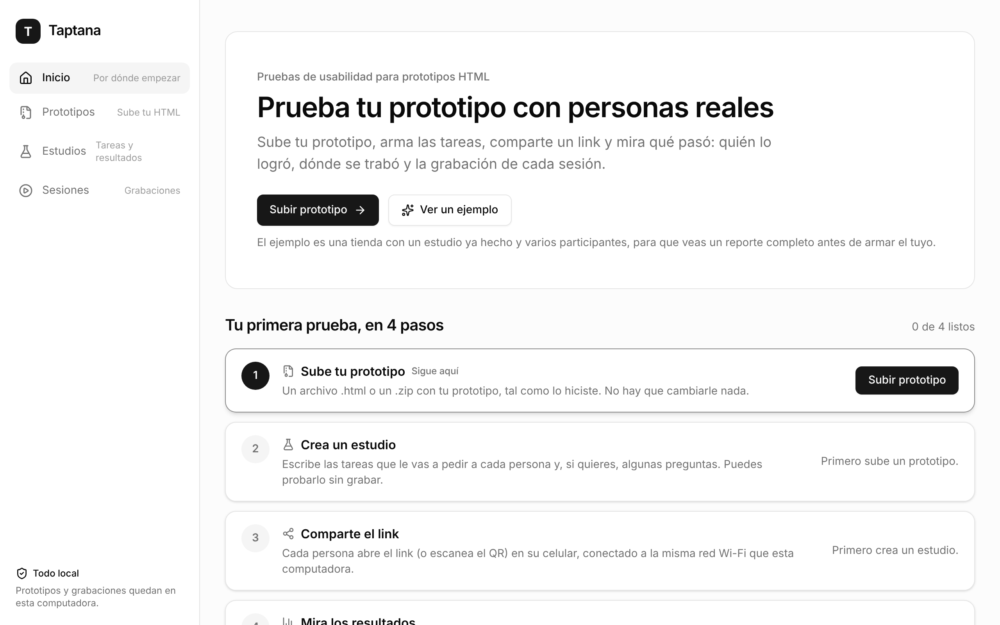
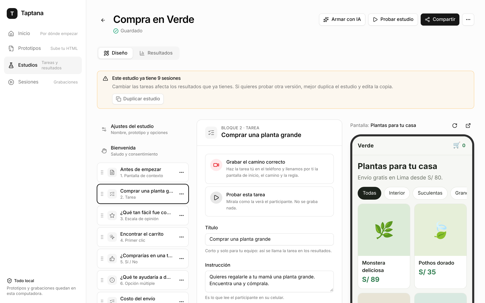
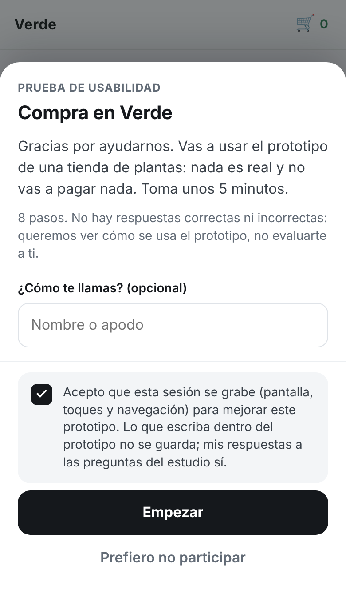
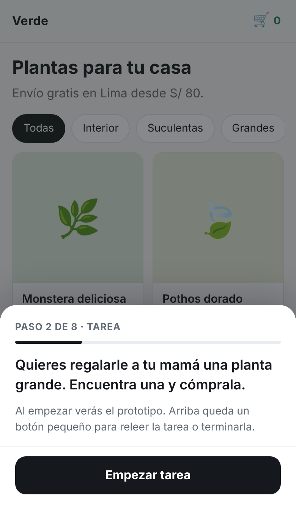
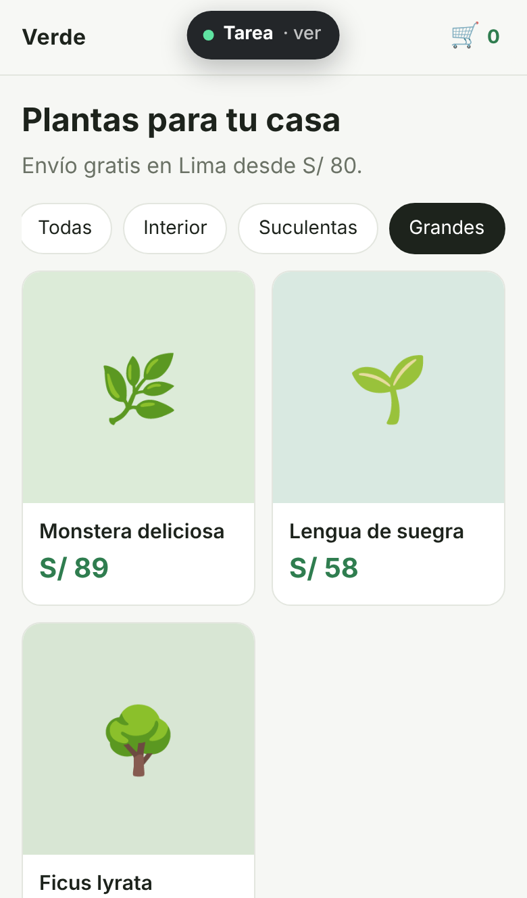
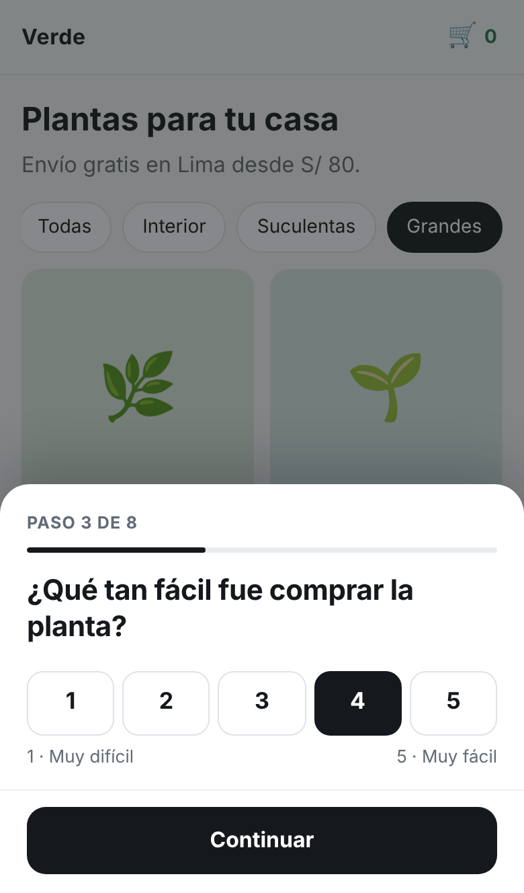
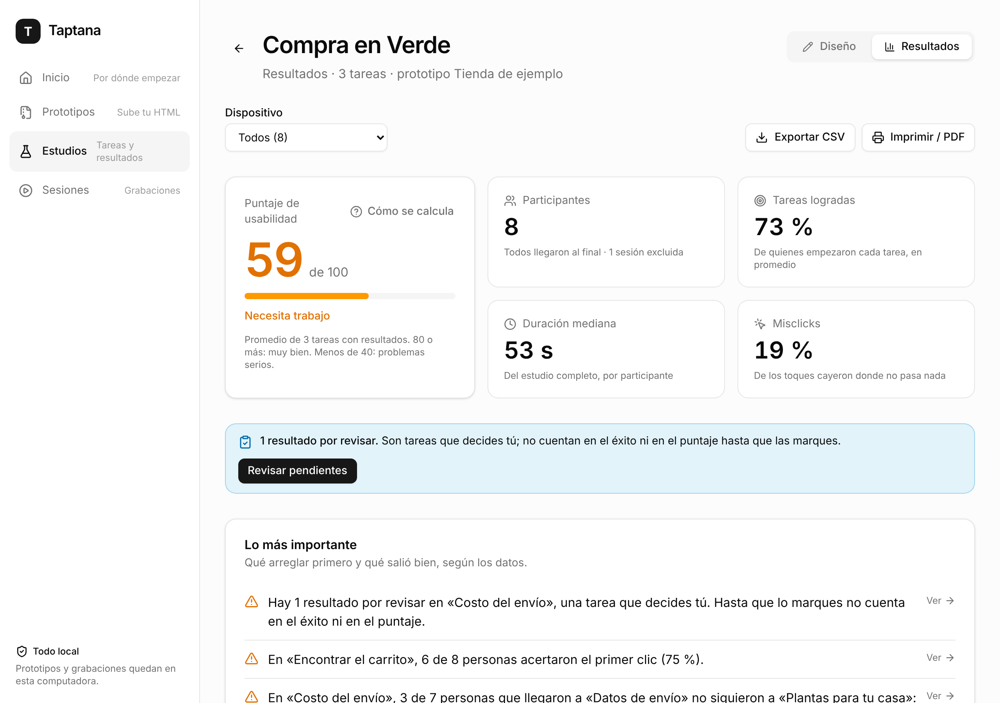
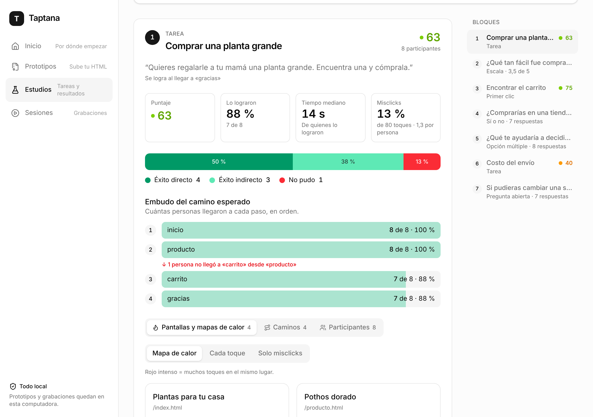
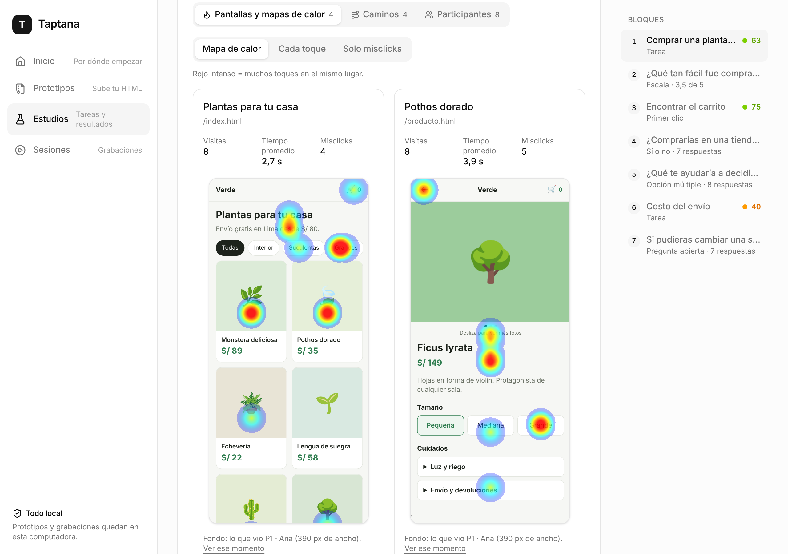

# Guía: tu primera prueba de usabilidad con Taptana

Para diseñadores. No hace falta saber programar. Si algo no sale como dice aquí, mira
[Si algo falla](#si-algo-falla) al final.

## Lo que necesitas

- Una computadora con [Node 22.5 o más nuevo](https://nodejs.org) y [pnpm](https://pnpm.io/es/installation).
- Tu prototipo: un archivo `.html` o una carpeta comprimida en `.zip` ([qué prototipos funcionan](prototipos.md)).
- Una red Wi-Fi a la que se conecten tu computadora y los celulares de los participantes.

## 1. Arranca Taptana

En la carpeta del proyecto:

```
pnpm start
```

Se abre el panel en tu navegador. En la terminal queda algo así:

```
Panel en esta computadora:     http://localhost:4321/panel
Panel desde otro dispositivo:  http://192.168.1.20:4321/panel?key=…
```

Deja esa ventana abierta mientras dure la prueba: si la cierras, Taptana se apaga. Para
apagarlo a propósito, `Ctrl + C`.

¿Primera vez? Toca **Ver un ejemplo** en Inicio para conocer un estudio terminado.



## 2. Sube tu prototipo

**Prototipos → Subir prototipo.** Elige tu `.html` o tu `.zip`. Taptana lo guarda en tu
computadora y te muestra las pantallas que encontró. Si tu prototipo usa direcciones que
empiezan con `/` (pasa con algunas apps hechas con IA), el panel te sugiere activar
**Abrir en la raíz**.

Cuando cambies el prototipo, sube la **nueva versión** sobre el mismo: los estudios siguen
apuntando a él.

## 3. Arma el estudio

**Estudios → Nuevo estudio.** El estudio es una lista de bloques que la persona recorre en orden.



1. **Bienvenida.** Saluda, di cuánto toma y que nada es real. El consentimiento ya viene escrito.
2. **+ Agregar bloque** para cada paso. Lo más común:
   - **Contexto**: sitúa a la persona ("Imagina que quieres regalar una planta…").
   - **Tarea**: algo que debe lograr en el prototipo.
   - **Primer clic**: "¿Dónde tocarías para…?". Solo cuenta el primer toque.
   - **Preguntas**: escala del 1 al 5, opción múltiple, sí o no, abierta.
3. En cada tarea, toca **Grabar el camino correcto** y haz tú la tarea en el teléfono de la
   derecha. Al terminar, **Usar este camino** llena solo la pantalla de inicio, el camino
   esperado y la regla de éxito.
4. **Probar estudio**: lo recorres como participante, sin que se grabe nada.

Se guarda solo. Si prefieres que una IA te proponga el estudio: [Estudios con IA](estudios-con-ia.md).

### Cómo escribir buenas tareas

- **Cuenta una situación, no des instrucciones.** Bien: "Quieres regalarle a tu mamá una
  planta grande. Encuentra una y cómprala." Mal: "Toca Grandes, elige una planta y toca Pagar."
- **No uses las palabras de la interfaz.** Si el botón dice "Carrito", pregunta "¿dónde verías
  lo que llevas?".
- **Una cosa por tarea**, con un final claro.
- **Pocas**: dos o tres tareas y cuatro o cinco preguntas. Cinco minutos en total.
- **Empieza por lo fácil** para que la persona entre en confianza.
- **Después de la tarea importante, pregunta qué tan fácil fue** (escala del 1 al 5).
- **Termina con una pregunta abierta**: "Si pudieras cambiar una sola cosa, ¿cuál sería?".
- Di que pueden inventar los datos: lo que escriban en el prototipo no se guarda.

### Cómo sabe Taptana que una tarea se logró

| Regla | Cuándo usarla |
|---|---|
| **Llega a una pantalla** | El flujo termina en una pantalla clara (la confirmación de compra). La más confiable. |
| **Toca un elemento** | La tarea es encontrar algo (el carrito, un filtro). Lo eliges tocándolo en el teléfono. |
| **Aparece un texto o elemento** | El prototipo no cambia de pantalla (sale un aviso "Guardado"). |
| **Lo decide el moderador** | Nada de lo anterior alcanza ("averigua cuánto cuesta el envío"). Lo marcas tú después. |

## 4. Comparte el link

En el estudio, **Compartir** te da el link, un código QR y un mensaje de invitación listo para
copiar. El participante **no necesita la llave del panel**: su link solo abre el prototipo.

### Prueba moderada (estás con la persona)

1. Pídele que conecte su celular a la misma red Wi-Fi y que escanee el QR.
2. Dile lo de siempre: "No te estamos evaluando a ti, sino al prototipo. Piensa en voz alta."
3. No ayudes ni señales la pantalla. Si se traba, pregunta "¿qué esperabas que pasara?".
4. Anota lo que diga. Después puedes pegar tus notas en su sesión.
5. Con tareas "Lo decide el moderador", fíjate si de verdad lo logró: lo marcas luego.

### Prueba no moderada (cada quien por su cuenta, en la oficina)

1. Manda el mensaje de invitación por el chat del equipo. Aclara: "funciona solo conectado
   al Wi-Fi de la oficina".
2. Tu computadora tiene que quedar encendida, sin suspenderse, con Taptana corriendo.
3. Activa "pedir nombre" en la Bienvenida si quieres saber quién es quién.
4. Cuando tengas suficientes respuestas, apaga **Recibe respuestas** en el estudio.

Con cinco a ocho personas ya aparecen los problemas principales.

Lo que ve el participante: bienvenida con consentimiento, la instrucción de cada tarea, el
prototipo con una píldora "Tarea" arriba (para releer, terminar o decir "No pude") y las
preguntas.

<p>
  
  
  
  
</p>

## 5. Lee el reporte

En el estudio, pestaña **Resultados**.



Arriba está el puntaje y **Lo más importante**: un resumen, hecho con reglas fijas (sin IA),
de qué arreglar primero y qué salió bien. Abajo, una sección por bloque.



Antes de sacar conclusiones:

- **Revisa lo pendiente.** Las tareas que decides tú aparecen "por revisar" hasta que marques
  "Lo logró" o "No lo logró". Mientras tanto no cuentan.
- **Excluye las sesiones de prueba** (las tuyas, las del equipo): en la sesión, "Excluir del
  reporte".
- **Mira las grabaciones** de quienes no pudieron. El número dice dónde; la grabación, por qué.



**Exportar CSV** baja una fila por participante para tu hoja de cálculo. **Imprimir / PDF**
arma el reporte para compartir.

### Qué significa cada número

- **Participantes**: sesiones del estudio que aceptaron grabar y no están excluidas. Cada
  tarea cuenta solo a quienes la empezaron.
- **Éxito**: se cumplió la regla de la tarea, o tú la marcaste como lograda.
  - **Directo**: siguió exactamente el camino esperado.
  - **Indirecto**: lo logró, pero dando vueltas.
  - Si no definiste un camino esperado (y no se puede deducir), todo éxito cuenta como directo.
  - Si logró la tarea y después tocó "No pude", sigue contando como éxito.
- **No pudo**: tocó "No pude" sin haberlo logrado. **Sin terminar**: empezó la tarea y se fue.
- **Por revisar**: tarea que decides tú, donde la persona tocó "Listo" y aún no la marcas. No
  cuenta en el éxito ni en el puntaje hasta que la marques.
- **Tiempo de una tarea**: desde "Empezar tarea" hasta que se cumple la regla (o hasta "Listo"
  o "No pude" si no se cumplió). Leer la instrucción no cuenta. El **tiempo mediano** es solo
  de quienes lo lograron.
- **Misclick**: un toque sin efecto sobre algo que no es tocable (un título, una imagen de
  adorno). Muchos misclicks en un mismo lugar significan que eso parece un botón y no lo es.
- **Primer clic**: acierto si el primer toque cae en el elemento buscado (o lleva a la
  pantalla buscada en los 2 segundos siguientes). Cualquier otro toque es "No pudo".
- **Embudo**: cuántas personas llegaron a cada pantalla del camino esperado, en orden. El paso
  con la mayor caída es donde más gente se pierde.
- **Puntaje de usabilidad de una tarea** (0 a 100):
  `100 × directo + 50 × indirecto − 50 × tasa de misclicks − penalización por tiempo`.
  Las tasas van de 0 a 1 sobre los intentos ya decididos. La penalización por tiempo va de 0 a
  10 puntos: empieza cuando la mediana pasa de 5 segundos por pantalla y sube medio punto por
  segundo extra. En primer clic es simplemente el porcentaje de aciertos.
- **Puntaje del estudio**: el promedio de las tareas que tienen resultados decididos. 80 o
  más: muy bien. Menos de 40: problemas serios.
- **Mapas de calor**: se dibujan sobre lo que vio un participante real, con los toques de
  pantallas de ancho parecido (±20 %). El reporte dice cuántos toques quedaron fuera por venir
  de pantallas de otro tamaño.

## Tus datos

Todo queda en la carpeta `.taptana` dentro del proyecto: prototipos, estudios y grabaciones.

- **Respaldo**: copia esa carpeta.
- **Borrar todo**: apaga Taptana y borra esa carpeta.
- **Pasar una sesión a otra persona**: en la sesión, "Exportar sesión"; la otra persona la
  importa en Sesiones.
- Lo que los participantes escriben dentro del prototipo nunca se guarda. Sus respuestas a
  las preguntas del estudio sí.

## En un servidor con Docker

Para dejar Taptana corriendo en una máquina de la oficina (pídele ayuda a alguien técnico):

```
TAPTANA_PUBLIC_URL=http://192.168.1.20:4321 docker compose up -d
docker compose logs taptana
```

`TAPTANA_PUBLIC_URL` es la dirección con la que los celulares llegan a esa máquina; sin ella,
los links y los QR salen mal. En los registros aparece el **link del panel con su llave**
(`…/panel?key=…`): dentro de Docker el panel siempre se abre con ese link, también desde la
misma máquina. Los datos quedan en el volumen `taptana-data` (carpeta `/data` del contenedor).

## Si algo falla

**El celular no abre el link.**
- ¿Está en la **misma red Wi-Fi** que tu computadora? Con datos móviles no funciona. Las redes
  de "invitados" suelen impedir que los equipos se vean entre sí: usa la red normal.
- ¿Taptana sigue corriendo? Mira la terminal. ¿La computadora se suspendió?
- ¿El link empieza con `localhost`? Ese solo sirve en tu computadora. Usa el de Compartir, que
  lleva un número como `192.168.1.20`.
- **Firewall**: la primera vez, Windows o macOS preguntan si Node puede aceptar conexiones.
  Hay que decir que sí (Permitir). Si dijiste que no: en macOS, Ajustes del Sistema → Red →
  Firewall → Opciones; en Windows, "Permitir una aplicación a través del Firewall" y marca
  Node.js en redes privadas. El puerto que usa Taptana es el **4321**.
- Algunas redes de oficina bloquean la comunicación entre equipos. Prueba con el punto de
  acceso (hotspot) de un celular: conecta ahí la computadora y el celular del participante.

**"El puerto 4321 está ocupado".** Taptana toma el siguiente libre y te lo dice; los links ya
salen con el puerto correcto. Para elegirlo tú: `pnpm start --port 5000`.

**"El panel solo se abre desde la computadora donde corre Taptana".** Es la protección del
panel: tus grabaciones no quedan abiertas a toda la red. Para entrar desde otro dispositivo,
usa el link "Panel desde otro dispositivo" de la terminal (lleva `?key=…`). Es una llave: no
se la mandes a los participantes. Vive en `.taptana/panel.key`; si borras ese archivo y
reinicias, se crea una nueva.

**El participante ve "No pudimos cargar el estudio".** Revisa que el link esté completo
(termina en `?study=…`) y que Taptana siga corriendo. "Este estudio ya no recibe respuestas"
significa que lo cerraste: vuelve a activar "Recibe respuestas".

**El prototipo se ve sin estilos o no navega.** Mira [prototipos.md](prototipos.md):
casi siempre son direcciones que empiezan con `/` y se arregla con "Abrir en la raíz".

**Una tarea nunca se marca como lograda.** Pruébala con "Probar esta tarea". Si la regla es
"Llega a una pantalla" y tu prototipo no cambia de página, revisa en Prototipos qué pantallas
detectó Taptana; puede hacer falta marcar las pantallas con `data-screen`
([cómo](prototipos.md#pantallas-en-una-sola-página)).

**`pnpm start` dice que necesita Node 22.5.** Instala la versión actual desde nodejs.org y
vuelve a correrlo.
